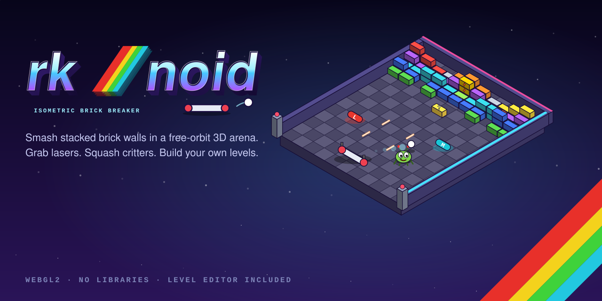
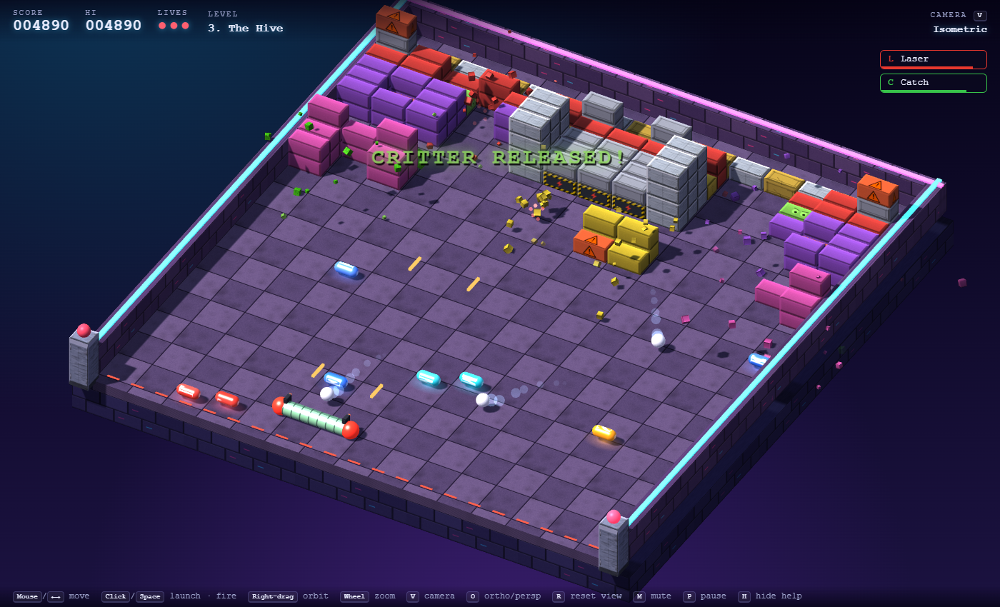
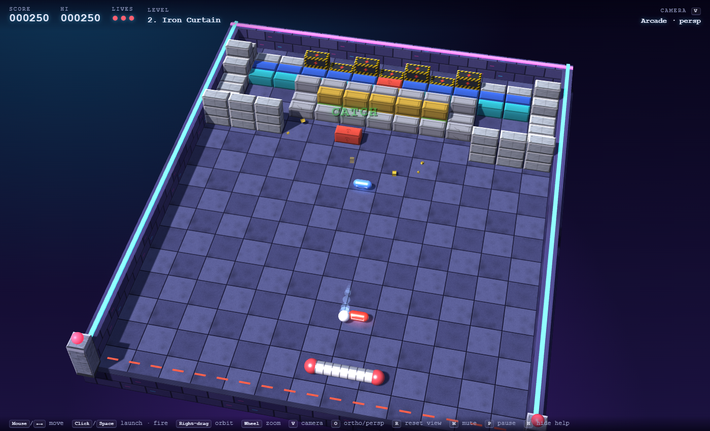
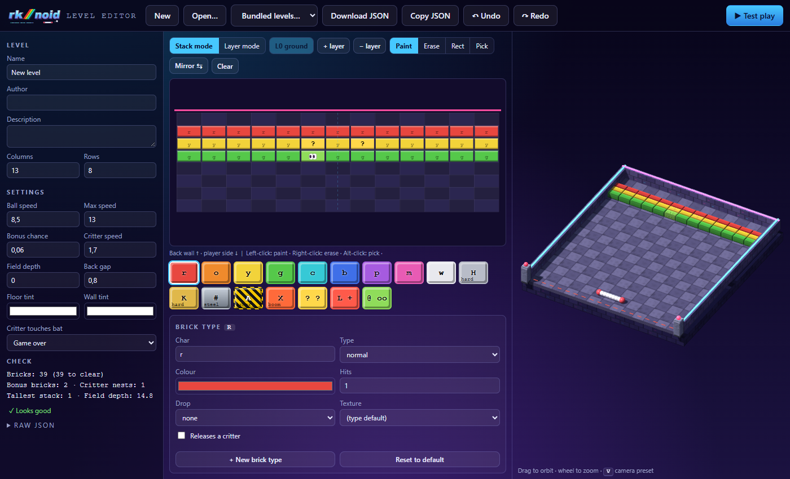

<p align="center"></p>

# rk/noid

**rk/noid** is a browser brick breaker in the spirit of *Arkanoid* (Taito, 1986) and the isometric
ZX Spectrum classic *Ballbreaker* (CRL, 1987). The arena is fully 3D: the default view is an isometric camera,
and you can orbit it freely with the mouse. Bricks form **vertical walls**: stacks of blocks that drop down
when you knock out the one underneath.

It's written in plain HTML and JavaScript on top of **raw WebGL2**. There's no backend, no build step and no
third-party libraries, and every texture and sound is generated in code at startup.



## Quick start

Browsers block `fetch()` on `file://` pages, so the levels in `levels/*.json` won't load if you double-click
`index.html`. Serve the folder with any static web server instead:

```bash
# Python 3
python -m http.server 8000
# or Node
npx http-server -p 8000
```

Then open <http://localhost:8000/> for the game and <http://localhost:8000/editor.html> for the level editor.

You need a browser with WebGL2: any current Chrome, Edge, Firefox or Safari.

## Controls

| Action | Mouse | Keyboard |
| --- | --- | --- |
| Move the bat | move the pointer (the bat follows it on the floor, from any camera angle) | `←` `→` or `A` `D` |
| Launch the ball / fire lasers | left click (hold to auto-fire) | `Space` |
| Orbit the camera | right-drag (or `Shift` + left-drag) | |
| Zoom | mouse wheel | |
| Next camera preset | | `V` |
| Orthographic ↔ perspective | | `O` |
| Reset the camera | | `R` |
| Pause | | `P` / `Esc` |
| Mute | | `M` |
| Hide the help bar | | `H` |

### Language

The game and the editor are available in **English** and **Czech**. Use the **EN | CZ** switch in the top-right
corner of the menu, in the pause screen, or in the editor toolbar. The choice is remembered in `localStorage`.
On a first visit the language follows the browser (Czech or Slovak browser → Czech). You can also force it in
the URL with `?lang=cs` or `?lang=en`.

Camera presets: **Isometric** (default, orthographic), **True iso 45°** (the classic Ballbreaker angle),
**Arcade** (perspective from behind the bat), **Low chase** and **Top-down**. The two projections blend
smoothly into each other.

## Game design

### Core loop

The ball moves on the floor plane, so the physics is 2D in X/Z, just like the original games. Height is
used for presentation only: the ball hops visually and casts a real shadow, bricks are stacked, and critters
climb over stacks. Your bat sits at the front of the arena; behind it there's no wall, and a ball that gets
past the bat costs you a life. The exit angle off the bat depends on where the ball hits it (up to ±60°).
The ball speeds up a little with every brick you destroy, up to a per-level cap.

### Vertical walls (stacks)

Every grid cell holds a **stack** of bricks. Only the **bottom** brick of a stack can be hit, by the ball or
by projectiles. When it's destroyed, the bricks above fall down one layer with a little gravity animation.
Tall stacks therefore take several hits to clear, and anything stacked on top of an indestructible brick
stays out of the ball's reach.

### Brick types

| Type | Hits | Ball | Laser | Notes |
| --- | --- | --- | --- | --- |
| `normal` | 1 | ✔ | ✔ | Plain coloured brick. Each one has a small chance (`bonusChance`) to drop a random capsule. |
| `hard` | 2 (configurable) | ✔ | ✔ | Riveted plate. Shows cracks as it takes damage. |
| `steel` | ∞ | ✖ | ✖ | Indestructible. Doesn't count toward clearing the level. |
| `armored` | 1 | ✖ | ✔ | Hazard-striped. **Only projectiles can destroy it**, and the ball just pings off. |
| `explosive` | 1 | ✔ | ✔ | Blows up after a short fuse, destroying the bottom brick of all 8 neighbouring stacks (armored bricks included, steel excepted), and kills critters nearby. Chains into other explosives. |

Any brick can also be given:

* `"drop": "<bonus>"` or `"drop": "random"`: guarantees a capsule when it's destroyed. These bricks are drawn with a **?** texture.
* `"critter": true`: a **critter nest**. When destroyed, it releases a critter instead of a capsule. These bricks have eyes peeking out.

A built-in safety net makes sure armored bricks never soft-lock a level. When the ball hits an armored brick
while no laser is active or on its way, and nothing reachable by the ball is left, the brick drops a laser
capsule.

### Bonus capsules

Capsules slide across the floor toward you. Touch one with the bat to collect it. Timed effects are shown in
the top-right corner with a countdown bar.

| Capsule | Effect | Duration |
| --- | --- | --- |
| **L** Laser | Two guns appear on the bat and fire projectiles (click / `Space`, hold to auto-fire). This is the only way to break armored bricks, and it also kills critters. | 12 s |
| **E** Expand | Wider bat | 15 s |
| **S** Slow | Ball moves at about 60% speed | 12 s |
| **M** Multi-ball | Every ball splits into three (max 12) | – |
| **C** Catch | The ball sticks to the bat. Click to release it, or wait 3 s. | 15 s |
| **X** Mega ball | The ball smashes straight through every brick it's allowed to break | 8 s |
| **P** Extra life | +1 life | – |

### Critters

Destroying a critter nest releases a little green critter. It walks toward the player's side, **homing in
on your bat** with limited sideways speed, and climbs over any brick stacks in its path. **If it touches
your bat, the game is over.** (A level can soften this to "lose a life" with `critterMode`.)

Your main defence is to **avoid it**: move the bat out of its way and let it walk past your bat line, where
it leaves the arena. Because it turns slowly, it can be outrun. The ball can't hurt a critter; it just
bounces off, and the critter flinches. That makes a critter in front of the bat an obstacle, and you still
have to keep the ball in play while you dodge. Only two things kill it, each for 250 points:

* **laser** shots (grab an **L** capsule), and
* **explosions** from an explosive brick going off nearby.

### Scoring

| Event | Points |
| --- | --- |
| Normal / hard / explosive / armored brick | 50 / 120 / 80 / 200 |
| Critter (laser or explosion) | 250 |
| Capsule collected | 100 |
| Level clear | 1000 + 250 per remaining life |

The hi-score is saved in your browser's `localStorage`.

## Demo levels

| # | Name | Introduces |
| --- | --- | --- |
| 1 | **First Light** | Basic play, a few stacked bricks, bonus bricks, and a single critter nest in the middle of the field. |
| 2 | **Iron Curtain** | Steel walls, a back line of armored plates and guaranteed **L** bricks. Lasers are required to finish. |
| 3 | **The Hive** | Towers up to 4 high, explosives along the back, critter nests in every corner, and a nest sealed inside an armored core. Uses a custom legend entry (a pink hard brick that always drops multi-ball). |



## Level format

Levels are plain JSON files in `levels/`, listed in play order by `levels/index.json`:

```json
{ "levels": ["01-first-light.json", "02-iron-curtain.json", "03-the-hive.json"] }
```

A level is a stack of ASCII-art **layers**. Layer 0 is the ground; each further layer sits on top of the
previous one. In every layer, the first string is the row nearest the **back wall** and the last string is
the row nearest the player. Each character is one brick cell (1 unit wide, 0.5 units deep).

```json
{
  "format": "rk-noid-level@1",
  "name": "My Level",
  "author": "you",
  "description": "Shown in the level list.",
  "cols": 13,
  "rows": 4,
  "settings": {
    "ballSpeed": 8.5,
    "ballSpeedMax": 13,
    "bonusChance": 0.06,
    "critterSpeed": 1.7,
    "critterMode": "gameover",
    "floorColor": "#ffffff",
    "wallColor": "#ffffff"
  },
  "legend": {
    "Q": { "type": "hard", "hits": 3, "color": "#46c8ff", "drop": "laser" }
  },
  "layers": [
    [
      "AAAAAAAAAAAAA",
      "#rrrrr@rrrrr#",
      "#ooQoooooQoo#",
      "............."
    ],
    [
      ".............",
      "..rrr...rrr..",
      ".............",
      "............."
    ]
  ]
}
```

### Fields

| Field | Required | Description |
| --- | --- | --- |
| `format` | no | Always `"rk-noid-level@1"`. Reserved so the format can be versioned later. |
| `name`, `author`, `description` | no | Shown in the menu. |
| `i18n` | no | Translations of `name` / `description`, keyed by language, e.g. `{ "cs": { "name": "Úl", "description": "…" } }`. Missing entries fall back to the top-level English text. |
| `cols` | yes | Grid width, 3–31. |
| `rows` | yes | Grid depth, 1–30. |
| `layers` | yes | Array of layers. Each layer is an array of `rows` strings, each `cols` characters long. |
| `legend` | no | Extra or overriding brick definitions, keyed by a single character. They're merged over the built-in legend. |
| `settings` | no | Gameplay tuning. Every key is optional. |

`.`, space and `_` mean an empty cell. A brick with an empty cell below it simply falls onto the stack, and
the validator warns about it.

### Settings

| Key | Default | Meaning |
| --- | --- | --- |
| `ballSpeed` | 8.5 | Starting ball speed (units/s) |
| `ballSpeedMax` | 13 | Cap reached gradually as bricks break |
| `bonusChance` | 0.06 | Chance that a brick without an explicit `drop` releases a random capsule |
| `critterSpeed` | 1.7 | Forward walking speed of critters |
| `critterMode` | `"gameover"` | `"gameover"` or `"life"`: what a critter touching the bat costs you |
| `depth` | 0 (auto) | Arena depth. Auto = `rows × 0.5 + backGap + 10` |
| `backGap` | 0.8 | Empty strip between the back wall and row 0 (the ball can sneak behind the bricks) |
| `floorColor`, `wallColor` | `#ffffff` | Tints multiplied over the generated floor and wall textures |

### Built-in legend

| Char | Brick |
| --- | --- |
| `r o y g c b p m w` | normal: red, orange, yellow, green, cyan, blue, purple, magenta, white |
| `H` | hard, 2 hits |
| `K` | hard, 3 hits (gold) |
| `#` | steel |
| `A` | armored (laser only) |
| `X` | explosive |
| `?` | normal, drops a random capsule |
| `L` | normal, drops a **Laser** capsule |
| `@` | critter nest |

### Legend entry

```json
"Q": { "type": "hard", "hits": 3, "color": "#46c8ff", "drop": "laser", "critter": false, "tex": "bonus", "points": 300 }
```

| Key | Values |
| --- | --- |
| `type` | `normal`, `hard`, `steel`, `armored`, `explosive` |
| `hits` | Hits to destroy (ignored for steel) |
| `color` | Tint colour, `#rrggbb` |
| `drop` | `none`, `random`, `laser`, `expand`, `slow`, `multi`, `catch`, `life`, `mega` |
| `critter` | `true` makes it a critter nest |
| `tex` | Optional texture override: `brick`, `hard`, `bonus`, `critterBrick`, `explosive`, `armored`, `steel` |
| `points` | Optional score override |

### Validation

The loader (`parseLevel` in `js/level.js`) reports **errors**, which block play and testing, and
**warnings**. The editor shows both live. Current checks:

* grid size and layer shape, and unknown characters,
* floating bricks,
* a level with nothing destructible,
* **armored bricks with steel in front of them**: projectiles fly straight from the bat toward the back
  wall, so such a brick could never be destroyed. This is reported as an error.

## Level editor

Open `editor.html` (or **Level editor** in the menu).



* **Stack mode** (the default) treats each cell as a vertical wall. Left-click pushes the selected brick onto
  the top of the stack and right-click removes the top brick, with layers created and trimmed automatically.
  A small badge shows how tall each stack is.
* **Layer mode** edits one horizontal layer at a time (`L0 ground`, `L1`, …), with lower layers ghosted
  underneath. Number keys `0`–`9` switch layers.
* Tools: **Paint**, **Erase**, **Rect** (drag a rectangle to fill or erase), **Pick** (`Alt`+click also
  picks), **Mirror ⇆** (copy the left half onto the right) and **Clear**.
* **Palette and brick type panel**: pick a legend entry, then edit its character, type, colour, hits, drop,
  texture and critter flag. **+ New brick type** creates a custom legend entry. Editing a built-in entry
  stores an override in the level's `legend`, and **Reset to default** removes it.
* **Level / Settings** panels on the left hold everything from the format above, including the Czech name
  and description (stored in the level's `i18n` block). Changing columns or rows
  resizes every layer.
* **Live 3D preview** on the right, using the game's own renderer. Drag to orbit, use the wheel to zoom, and
  press `V` to cycle camera presets. The cell under the cursor is highlighted in 3D.
* **Check** shows brick counts and the validator's errors and warnings as you edit.
* **Raw JSON**: view, hand-edit and apply the JSON directly.
* **Undo / Redo** (`Ctrl+Z` / `Ctrl+Y`), plus autosave to `localStorage`, so a reload doesn't lose your work.
* **Download JSON** / **Copy JSON** / **Open…** / **Bundled levels…** for loading and saving.
* **▶ Test play** opens the game in a new tab, playing exactly the level you're editing.

To add a level to the game, save it into `levels/` and add its file name to `levels/index.json`. You can
also play any level file without installing it: use **Open level file…** in the game menu.

## Project structure

```
index.html            game page (menu, HUD, overlays)
editor.html           level editor page
css/style.css         game + shared UI styles
css/editor.css        editor layout
js/main.js            game bootstrap: level loading, input, HUD, menu, attract mode, main loop
js/game.js            game rules and simulation (ball physics, stacks, bonuses, critters, lasers, particles, autopilot)
js/level.js           level format: brick/bonus definitions, built-in legend, parseLevel() + validation
js/scene.js           shared assets and draw helpers (arena, bricks) used by game and editor
js/gl.js              WebGL2 renderer: Blinn-Phong + hemisphere light, PCF shadow map, blended pass
js/camera.js          orbit camera, presets, ortho/perspective blend, mouse picking rays
js/meshes.js          procedural geometry (box, sphere, cylinder, capsule, quad)
js/textures.js        procedural canvas textures (bricks, cracks, steel, hazard plates, floor, walls, capsules)
js/audio.js           WebAudio beeper synth for the sound effects
js/math.js            small matrix/vector helpers and a seeded PRNG
js/i18n.js            English + Czech dictionaries, t()/tn() lookups, data-i18n DOM binding, language switch
js/editor.js          level editor
levels/               index.json + demo levels
assets/               logo, favicon, cover art, screenshots
tests/soak.html       headless simulation test
```

### Rendering notes

* A single shader handles everything: textured Blinn-Phong, hemisphere ambient, rim light, distance fog,
  and a 2048² depth shadow map sampled with 3×3 hardware PCF.
* "Orthographic" mode really is orthographic once the transition finishes. While switching, the camera
  dolly-zooms (narrowing the FOV while pulling back) so the change is smooth.
* All textures are drawn on 2D canvases at startup from a seeded PRNG, so they look identical every run.
  Brick textures are mostly grey and get tinted by each legend entry's colour.
* The draw list is rebuilt every frame (a few hundred draw calls), which is plenty fast at this scale.
  Instancing would be the next step for much bigger levels.

## Translations

All UI text lives in `js/i18n.js`, in one dictionary per language (`STRINGS.en`, `STRINGS.cs`):

* Static HTML gets its text from attributes: `data-i18n` (text), `data-i18n-html` (markup), `data-i18n-title`
  and `data-i18n-placeholder`.
* Scripts call `t('key', { param })`, or `tn('key', n)` for plurals. Plural forms are separated by `|`:
  English has `one|other`, Czech has `one|few (2–4)|many`.
* Level-validator messages are translated as well, so the editor's **Check** panel follows the selected
  language.

To add a language, add a dictionary to `STRINGS`, list it in `LANGS`, and extend `pluralIndex()` if its
plural rules differ. Missing keys fall back to English.

## Testing

`tests/soak.html` plays every bundled level headlessly with the built-in **autopilot**, using a fixed
120 Hz time step. It checks that the ball never tunnels into a brick or leaves the arena, that no NaNs
appear, and that drawing never throws. It also reports whether each level could be cleared and which brick
types remain.

```
http://localhost:8000/tests/soak.html            # 400 simulated seconds per level
http://localhost:8000/tests/soak.html?seconds=900
```

Developer URL flags for the game:

| Flag | Effect |
| --- | --- |
| `?level=N` | Skip the menu and start at level N |
| `?demo=1` | The autopilot plays for you |
| `?warp=S` | Fast-forward S seconds of autopilot play at startup (for screenshots) |
| `?cam=N` | Start with camera preset N |
| `?test=1` | Play the level stored by the editor's **Test play** |
| `?lang=cs` / `?lang=en` | Force the UI language |

`window.rknoid` exposes `{ game, camera, renderer }` in the browser console.

## Ideas / roadmap

* Moving bricks and bricks that regenerate, teleporters, one-way gates.
* Multiple critter species: fast runners, critters that eat bricks, critters that carry capsules.
* Boss level: a giant critter queen that keeps spawning critters.
* Music (a tracker-style chiptune made with the same WebAudio synth).
* Touch controls tuned for phones (the bat already follows touch-drag).
* In the editor: paint directly in the 3D preview, copy/paste selections, level-pack export, thumbnails.
* Online level sharing via URL (levels are small; gzip + base64 fits in a link).

## Credits

Game design and code: rk/noid. Inspired by *Arkanoid* (Taito) and *Ballbreaker* (CRL / ZX Spectrum).
All graphics and sounds are procedurally generated. No external assets are used.
